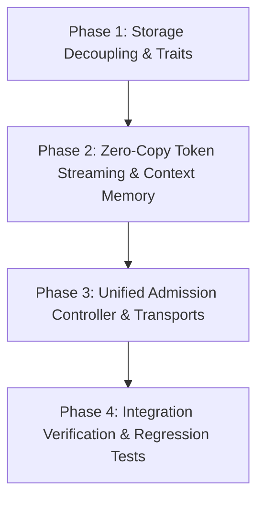

# Architectural Specification: Storage Abstraction, Zero-Copy Optimization, and Unified Admission Layers

## 1. Executive Summary

This specification establishes the target architecture for BaziFlowAgent across three core infrastructure pillars:

1. **Storage Abstraction**: Decoupling relational data, disposable chat history cache, and object storage behind dyn-compatible trait contracts (`UserRepository`, `LlmLogRepository`, `ChatCacheRepository`, `BlobStore`) under `Arc<dyn ...>`.
2. **Zero-Copy Streaming & Context Memory**: Transitioning token streaming to `bytes::Bytes` and conversation turn storage to `VecDeque<ChatTurn>` with `Arc<str>`, eliminating ~95% of heap allocations per streaming turn.
3. **Unified Transport Admission**: Centralizing concurrency semaphores, per-user sliding rate windows, single-flight turn locks, and fail-fast load shedding into `AdmissionController` in `Runtime`.

---

## 2. Storage Abstraction Layer (ADR 0001)

### Trait Contracts

All methods return `futures::future::BoxFuture<'a, AppResult<T>>` to ensure dynamic dispatch compatibility under Rust 2024 object safety rules.

```rust
use futures::future::BoxFuture;
use crate::models::error::AppResult;
use crate::models::common::LlmModel;
use crate::repos::{UserProfileData, UserSnapshotData, LlmLogParams};

pub trait UserRepository: Send + Sync + std::fmt::Debug {
    fn upsert_user_bazi<'a>(
        &'a self,
        user_id: u64,
        username: Option<&'a str>,
        bazi_four_pillars: &'a str,
        gender: u8,
        birth_datetime: &'a str,
    ) -> BoxFuture<'a, AppResult<()>>;

    fn save_user_bazi_analysis<'a>(&'a self, user_id: u64, reading: &'a str) -> BoxFuture<'a, ()>;
    fn save_user_bazi_summary<'a>(&'a self, user_id: u64, summary: &'a str) -> BoxFuture<'a, ()>;
    fn get_user_profile<'a>(&'a self, user_id: u64) -> BoxFuture<'a, UserProfileData>;
    fn get_user_snapshot<'a>(&'a self, user_id: u64) -> BoxFuture<'a, AppResult<UserSnapshotData>>;
    fn get_all_scheduled_users<'a>(&'a self) -> BoxFuture<'a, Vec<(u64, String)>>;
    fn update_user_schedule<'a>(&'a self, user_id: u64, schedule: Option<&'a str>) -> BoxFuture<'a, AppResult<()>>;
    fn get_user_rate_limit<'a>(&'a self, user_id: u64) -> BoxFuture<'a, Option<usize>>;
    fn set_user_rate_limit<'a>(&'a self, user_id: u64, rate_limit: Option<usize>) -> BoxFuture<'a, AppResult<()>>;
    fn get_user_last_active<'a>(&'a self, user_id: u64) -> BoxFuture<'a, AppResult<Option<i64>>>;
    fn get_user_last_active_formatted<'a>(&'a self, user_id: u64) -> BoxFuture<'a, AppResult<Option<String>>>;
    fn touch_user_last_active<'a>(&'a self, user_id: u64) -> BoxFuture<'a, AppResult<()>>;
    fn get_llm_models<'a>(&'a self) -> BoxFuture<'a, AppResult<Vec<LlmModel>>>;
    fn update_user_llm_model<'a>(&'a self, user_id: u64, llm_model: u8) -> BoxFuture<'a, AppResult<LlmModel>>;
    fn create_api_key<'a>(&'a self, user_id: u64) -> BoxFuture<'a, AppResult<String>>;
    fn get_auth_user_by_api_key<'a>(&'a self, raw_key: &'a str) -> BoxFuture<'a, Option<(u64, Option<usize>)>>;
    fn get_api_key_info<'a>(&'a self, user_id: u64) -> BoxFuture<'a, Option<(String, String)>>;
    fn get_username_by_user_id<'a>(&'a self, user_id: u64) -> BoxFuture<'a, Option<String>>;
}

pub trait LlmLogRepository: Send + Sync + std::fmt::Debug {
    fn save_llm_log<'a>(&'a self, params: LlmLogParams<'a>) -> BoxFuture<'a, ()>;
}

pub trait ChatCacheRepository: Send + Sync + std::fmt::Debug {
    fn save(&self, user_id: u64, role: CacheRole, content: &str) -> Result<(), ChatCacheQueueError>;
    fn clear<'a>(&'a self, user_id: u64) -> BoxFuture<'a, Result<(), ChatCacheQueueError>>;
    fn flush<'a>(&'a self) -> BoxFuture<'a, Result<(), ChatCacheQueueError>>;
    fn recent_turns<'a>(&'a self, user_id: u64, limit: usize) -> BoxFuture<'a, AppResult<Vec<ChatTurnRecord>>>;
}

pub trait BlobStore: Send + Sync + std::fmt::Debug {
    fn put<'a>(&'a self, key: &'a str, data: &'a [u8], content_type: Option<&'a str>) -> BoxFuture<'a, AppResult<()>>;
    fn get<'a>(&'a self, key: &'a str) -> BoxFuture<'a, AppResult<Vec<u8>>>;
    fn exists<'a>(&'a self, key: &'a str) -> BoxFuture<'a, AppResult<bool>>;
    fn presign_get<'a>(&'a self, key: &'a str, expiry_secs: u64) -> BoxFuture<'a, AppResult<String>>;
    fn delete<'a>(&'a self, key: &'a str) -> BoxFuture<'a, AppResult<()>>;
}
```

### Refactored AppState

```rust
pub struct AppState {
    pub runtime: Arc<crate::models::runtime::Runtime>,
    pub events: Arc<crate::models::events::EventHub>,
    pub http_client: reqwest::Client,
    pub user_repo: Arc<dyn crate::repos::UserRepository>,
    pub log_repo: Arc<dyn crate::repos::LlmLogRepository>,
    pub chat_cache: Arc<dyn crate::repos::ChatCacheRepository>,
    pub blob_store: Arc<dyn crate::repos::BlobStore>,
    pub config: Arc<AppConfig>,
    pub user_contexts: DashMap<u64, UserContext>,
    pub user_jobs: DashMap<u64, uuid::Uuid>,
    pub llm_service: Arc<dyn crate::services::llm::LlmService>,
}
```

---

## 3. Zero-Copy Pipeline Layer (ADR 0002)

### Streaming Transport

- `LlmStream` carries `mpsc::Receiver<tokio_util::bytes::Bytes>`.
- Delta tokens arriving from `async-openai` transfer into `Bytes::from(owned_string)` ($O(1)$ pointer transfer, no string reallocation).
- `Bytes::clone()` operates via atomic reference count increments without copying underlying byte buffers.
- `into_byte_stream()` plugs directly into Axum's `Body::from_stream` and WebSocket binary/text frames.

### Context Memory & Prompt Mapping

```rust
#[derive(Debug, Clone, Copy, PartialEq, Eq)]
pub enum ChatRole { User, Assistant, Tool }

#[derive(Debug, Clone, PartialEq, Eq)]
pub struct ChatTurn {
    pub role: ChatRole,
    pub content: Arc<str>,
}

pub struct UserContext {
    pub messages: VecDeque<ChatTurn>,
    pub total_bytes: usize,
    pub history_loaded: bool,
    pub last_active: chrono::DateTime<Utc>,
    pub is_processing: bool,
    pub profile_state: ProfileState,
    pub pick_state: PickState,
}
```

- Ring-buffer eviction via `pop_front()` runs in $O(1)$ time, eliminating $O(N)$ `memmove` calls.
- `total_bytes` tracked incrementally, eliminating repeated $O(N)$ byte-sum loops.
- `build_chat_messages` maps directly over `turn.role`, removing `format!("User: ")` and `strip_prefix` string roundtrips.

---

## 4. Unified Admission Layer (ADR 0003)

### Core Engine

`AdmissionController` in `Runtime` coordinates admission across Web API and Telegram transports:

```rust
pub struct AdmissionController {
    pub requests: Arc<Semaphore>,
    pub active_users: Arc<DashMap<u64, ()>>,
    pub rates: Arc<DashMap<u64, (Instant, usize)>>,
    pub shutdown: CancellationToken,
}
```

### RAII Lifecycle & Load Shedding

- Exposes `try_admit(user_id, rate_limit, require_exclusive) -> Result<AdmissionPermit, AdmissionRejection>`.
- Rejections fail fast without memory queueing:
  - `ServerShuttingDown`: HTTP 503 / Telegram maintenance message.
  - `MaxRequestsExceeded`: HTTP 429 (`Retry-After: 5`) / Telegram protection notice.
  - `RateLimitExceeded`: HTTP 429 (`Retry-After: 3600`) / Telegram cooldown notice.
  - `UserAlreadyProcessing`: HTTP 429 (`Retry-After: 2`) / Telegram in-progress notice.
- `AdmittedResponseStream` wraps response streams and holds `AdmissionPermit` until stream termination or disconnect, guaranteeing leak-free permit reclamation.

---

## 5. Implementation Phases



### Phase 1: Storage Decoupling & Repository Traits

1. Define trait declarations in `src/repos/traits/mod.rs` (`UserRepository`, `LlmLogRepository`, `ChatCacheRepository`, `BlobStore`).
2. Implement `SqliteUserRepository` and `D1UserRepository` adapting existing queries in `src/repos/mod.rs`.
3. Implement `SqliteChatCacheRepository` adapting `src/repos/chat_history_cache.rs`.
4. Implement `LocalFsBlobStore` and `R2BlobStore` adapting `src/services/bazi_service.rs` and `src/api/charts.rs`.
5. Update `AppState` and constructor in `src/models/state.rs` to take `Arc<dyn ...>` storage dependencies.

### Phase 2: Zero-Copy Token Streaming & Context Memory

1. Update `LlmStream` in `src/models/common.rs` to carry `tokio_util::bytes::Bytes`.
2. Update `call_llm` in `src/services/llm.rs` to convert delta text into `Bytes::from(content)` and eliminate `content.clone()`.
3. Simplify `src/services/conversation.rs` to eliminate secondary channel in `wrap_persisted_stream`.
4. Refactor `UserContext` in `src/models/state.rs` to use `VecDeque<ChatTurn>` with `Arc<str>` and incremental `total_bytes`.
5. Update `build_chat_messages` in `src/services/conversation.rs` to map directly over `ChatTurn`.

### Phase 3: Unified Admission Controller & Transports

1. Introduce `AdmissionController` and `AdmissionPermit` in `src/models/runtime.rs`.
2. Refactor `src/api/admission.rs` to use `AdmissionController::try_admit` and `AdmittedResponseStream`.
3. Add top-level cooperative load shedding filter in `src/main.rs` for Telegram updates.

### Phase 4: Integration Verification & Regression Tests

1. Run existing test suite (`cargo test`).
2. Run end-to-end API tests (`tests/api_tests.rs`) and Bazi flow tests (`tests/bazi_flow_tests.rs`).
3. Verify zero memory/allocation regressions.
