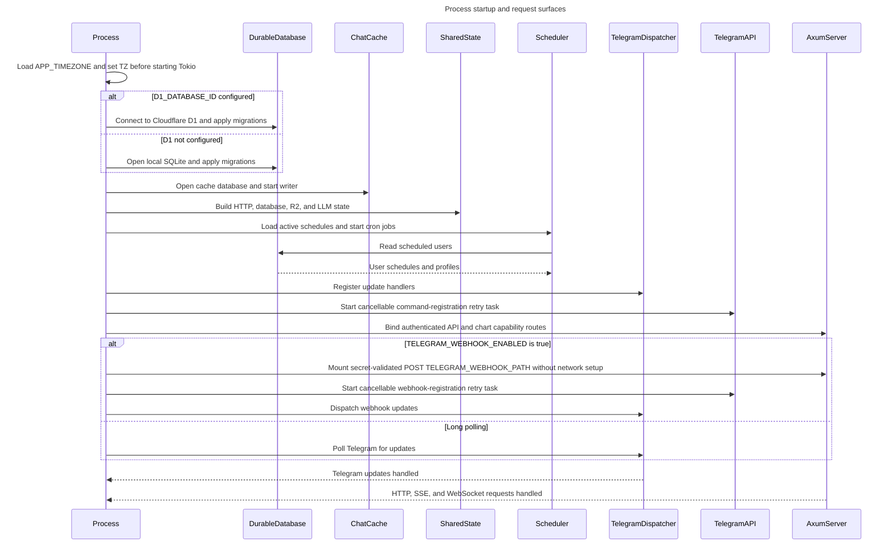
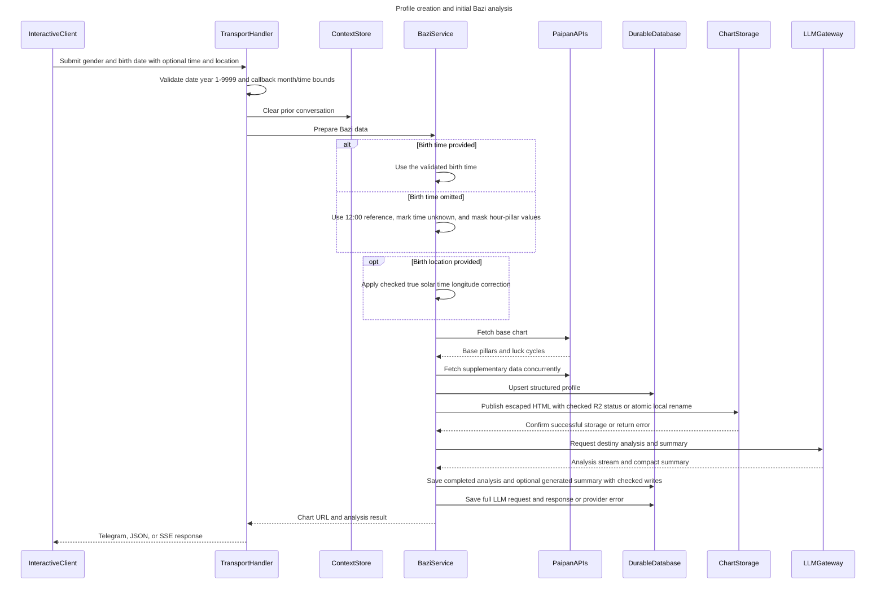
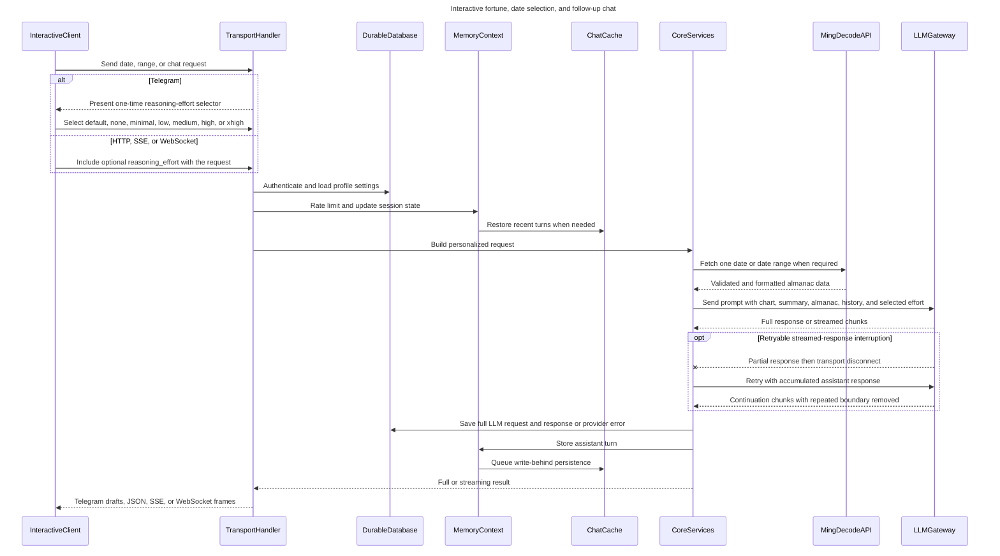
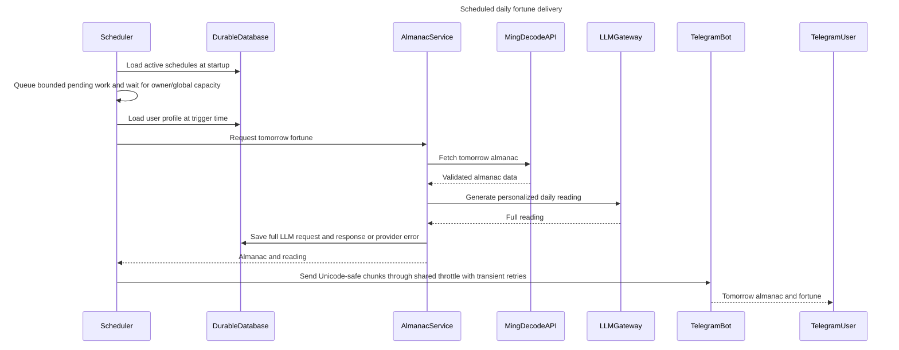
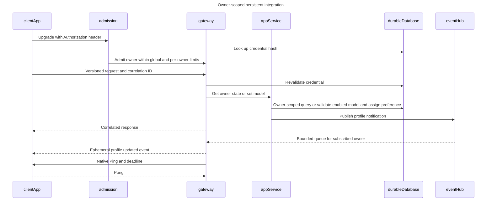
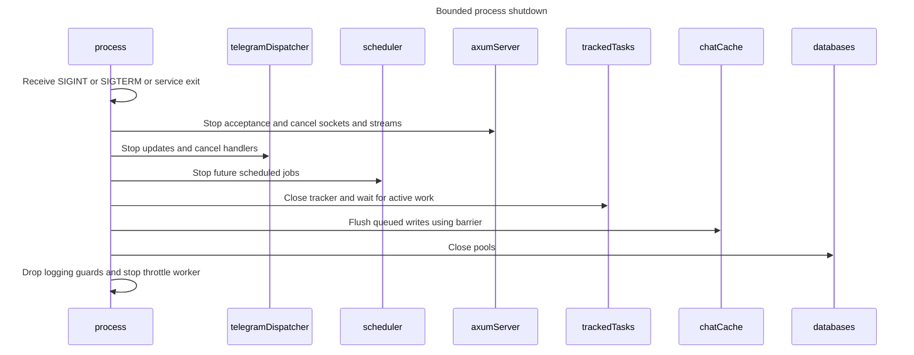

# BaziFlowAgent project flow

This document reflects the effective working tree updated on 2026-10-02. It covers process startup, profile creation, interactive readings/chat, and scheduled daily delivery.

## 1. Process startup and request surfaces

The durable database is Cloudflare D1 when `D1_DATABASE_ID`, `D1_ACCOUNT_ID`, and `D1_API_TOKEN` are configured; otherwise it is the local SQLite database selected by `DATABASE_URL`. D1 and SQLite apply the same immutable historical migrations plus new forward migrations. Durable timestamps remain UTC; `APP_TIMEZONE` controls user-facing time and cron scheduling, and startup sets process `TZ` before Tokio. The chat cache remains a separate, disposable local SQLite database. Database/scheduler initialization errors fail startup explicitly instead of silently discarding saved schedules.

Telegram command registration and optional webhook registration retry in cancellable background tasks, so a Telegram outage does not prevent HTTP availability. With `TELEGRAM_WEBHOOK_ENABLED=true`, the Axum listener mounts the configured path with a generated secret; registration sends the same secret to Telegram, and shutdown attempts webhook removal within five seconds. The proxy template forwards `/telegram/webhook`; change that location if `TELEGRAM_WEBHOOK_PATH` changes. Otherwise Teloxide uses long polling. The scheduler owns a `Bot` instance for centrally throttled scheduled delivery, without routing messages through the update dispatcher.

## 2. Profile creation and initial Bazi analysis

`InteractiveClient` represents either a Telegram user or an authenticated API client. `TransportHandler` represents the relevant teloxide handler or Axum endpoint. Birth time and birth location can both be omitted. An omitted time uses 12:00 only as a date-safe reference for the required upstream chart calculation; before the profile is stored or returned, every hour-pillar value is replaced with `*` and the time is marked unknown. An omitted location receives no longitude correction. `ChartStorage` is Cloudflare R2 when configured and the local `public/` directory otherwise.

Chart publication errors propagate instead of publishing a dead fallback URL or success event. A failed replacement can leave the new structured profile without a chart or analysis; it cannot expose the old chart as the new profile. Profile reads distinguish missing data from unavailable storage, and critical analysis/summary writes must succeed before HTTP completion. Telegram pending birth inputs survive chart preparation/publication failure. Idempotent chart/almanac GETs have at most two transient retries within a 30-second budget, including body/framing failures after response headers arrive.

## 3. Interactive fortune, date selection, and follow-up chat

Almanac retrieval applies to daily-fortune and date-selection requests. Follow-up chat skips that call and uses the stored structured chart, compact Bazi summary, and recent conversation turns. The shared LLM transport uses async-openai request/response types but reads HTTP/SSE directly: it alone owns the retry budget, raw-body limits, and producer backpressure. There are at most three actual HTTP attempts across initial and continuation requests, within one absolute LLM timeout. Integer retry-after values are capped at five seconds; shutdown and receiver closure cancel waits and reads.

Telegram asks for a reasoning level after every free-text question, `/date` selection, and `/pick` activity selection. HTTP/SSE clients send `reasoning_effort` in `/api/v1/chat` and `/api/v1/pick-date`; date-fortune WebSocket clients include it in their `generate` frame. Valid explicit values are `none`, `minimal`, `low`, `medium`, `high`, and `xhigh`. Telegram’s `Default` option and an omitted API field use `LLM_REASONING_EFFORT` when configured; Telegram’s `None` option explicitly sends `none`. Scheduled work has no interactive selector and continues to use the configured fallback.

Only an explicit `stop` finish reason with nonempty text is complete. Bare EOF, `[DONE]` without an acceptable finish reason, and token-limit endings resume within the remaining budget or fail. Non-retryable provider/schema errors fail immediately. Full response bodies and accumulated output are capped at one MiB; each SSE event is capped at 64 KiB, and production feeds a bounded application channel without a detached unbounded SDK queue. Continuation is a new model request containing accumulated text, not a byte-identical transport resume. Boundary deduplication is best-effort and does not guarantee identical prose.

Telegram drafts use an independent coalescing worker with a two-second edit deadline; drafts cannot block token draining. Durable message chunks retry transient delivery failures at most twice, retaining progress for chunks already sent. Delivery errors propagate and prevent recording a delivered assistant turn. Ambiguous Telegram timeouts can produce duplicates: these retries are at-least-once, not exactly-once, and pending delivery is not a durable outbox across process restarts.

## 4. Scheduled daily fortune delivery

Pending scheduled runs are bounded by `APP_MAX_CONTEXTS` and wait up to one hour for capacity; execution then has the normal `APP_WORK_SECONDS` deadline. The job re-reads its persisted cron before generation, so a disabled or replaced queued job does not deliver stale work. Queue overflow, expiry, permanent delivery errors, and exhausted upstream retries are logged; no unbounded queue or restart-surviving catch-up is claimed.

Schedule updates upsert preferences for new users, construct/add a replacement before removing the previous job, and propagate runtime installation/removal errors. Context cleanup also reconciles installed jobs against durable preferences under owner guards, re-reading preferences after admission. Transient reconciliation-query errors preserve existing jobs. The same scheduler expires stale contexts and applies `LOG_RETENTION_DAYS` to filesystem logs, durable LLM logs, and old chat-cache rows. Database/cache cleanup catches up in 1000-record batches with a 30-second deadline per store; existing logs receive an initial UTC timestamp in the new retention migration.

LLM logs store the serialized provider request, including private prompts, and the complete non-streaming response or assembled streaming text. Failed calls store provider error detail with any partial text and actual application retry count. All diagnostic writes have a five-second deadline before returning or acknowledging completion and do not retain generation capacity. Diagnostic logging remains best-effort; profile analysis/summary persistence is not best-effort.

## 5. Persistent third-party gateway

The gateway has no Telegram command passthrough. Its fixed capabilities are owner state reads, model assignments, and profile notifications. Available models and their autoincremented IDs can be queried via authenticated `GET /api/v1/models`. Model assignments (`PUT /api/v1/model` or gateway `set_model`) and the Telegram picker read the durable `llm_models` setting; disabled model IDs cannot be selected and existing disabled preferences fall back to `LLM_MODEL_NAME`. Invalid actions cannot select another owner/chat. Queue saturation cancels the slow connection; publisher work never awaits a subscriber. `/api/v1/date-fortune` remains a separate, bounded, single-reading compatibility protocol. See [protocol and limits](websocket-integration.md).

Credential lookup failure returns HTTP 503 during authentication, distinct from a genuinely invalid key. Revalidation fails closed: the persistent gateway uses retryable close code 1013 with `storage_unavailable` for storage errors and 1008 with `credential_revoked` only for an absent/revoked credential.

## 6. Shutdown and cleanup

Shutdown has a configured total drain deadline. Deadline expiry is logged and remaining service tasks are aborted as the runtime exits. In-memory processing contexts cannot be expired by cleanup. Telegram detached profile/selection work retains its admission guard until completion. HTTP SSE uses a tracked, bounded response producer that owns admission guards: the absolute deadline starts before authentication/handler execution and releases resources even if the response body is never polled. Consumer drop and shutdown cancel the producer; deadline expiration emits an error event when queue capacity permits. SSE keepalive comments prevent the supplied proxy's idle timeout during quiet generation/retry/summary work.

LLM producers stop on receiver cancellation, shutdown, output/event limits, or blocked-send deadlines. Completed-stream acknowledgement is required before persistence or success. Telegram handler errors/timeouts send a clean best-effort warning. The installer stages and verifies downloads before atomically replacing the executable, preserves a previous binary, and restores it when the immediate restart check fails; it does not perform an end-to-end application health check.

Local chart retrieval resolves a stateless AES-256-GCM capability token in memory without database lookups and serves the corresponding escaped HTML with no-store and no-referrer headers. It does not expose the filesystem directory. Caches are disposable; oversized history turns and full cache queues are rejected observably.

## Maintenance rule

When a code change affects any entry point, handler, service, external API, datastore, chart storage path, streaming protocol, scheduler job, or response path, update the affected sequence above in the same change. Add a new focused sequence when an independent flow cannot be represented accurately in an existing one.
